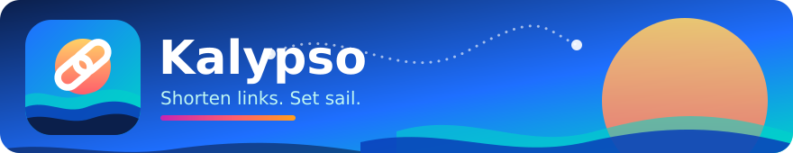
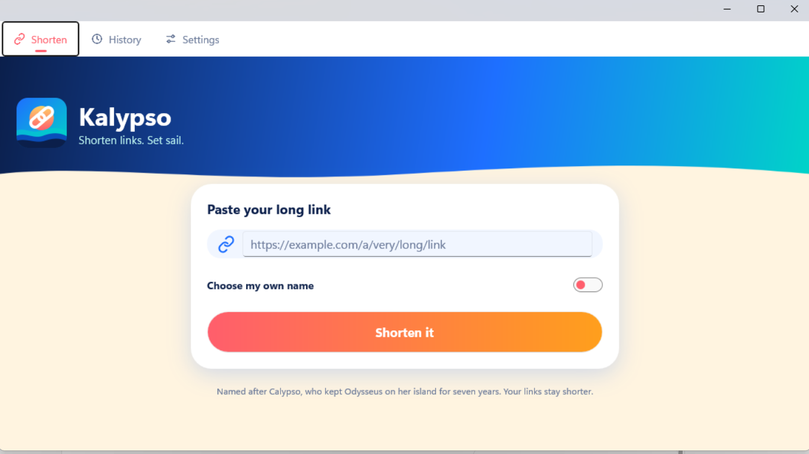
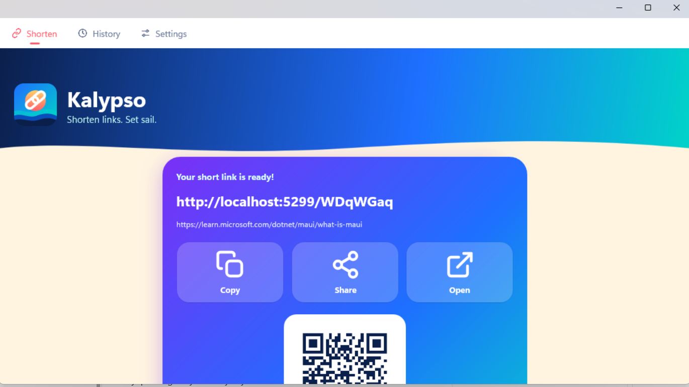
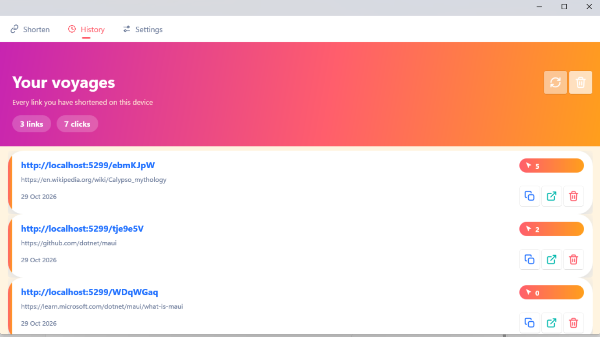
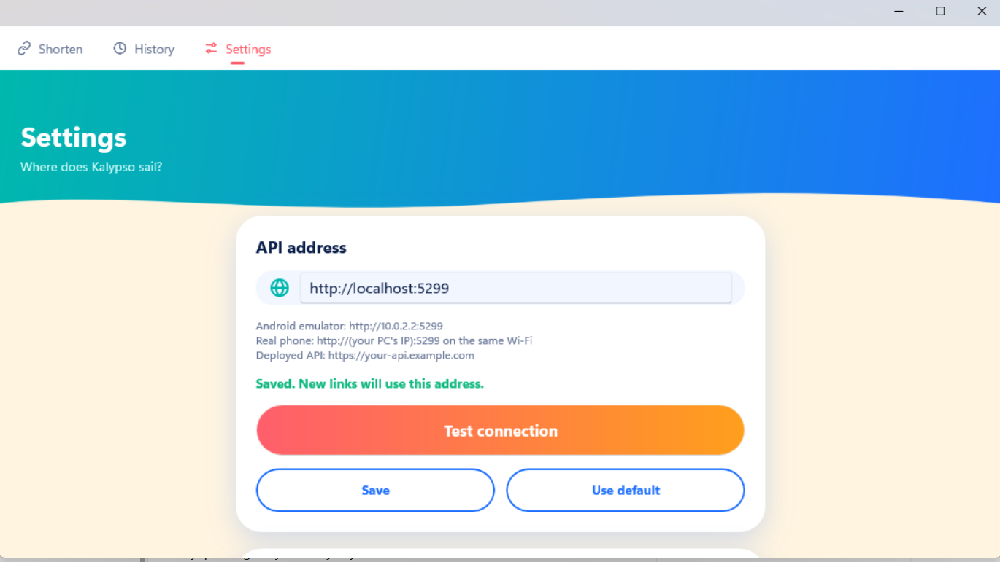
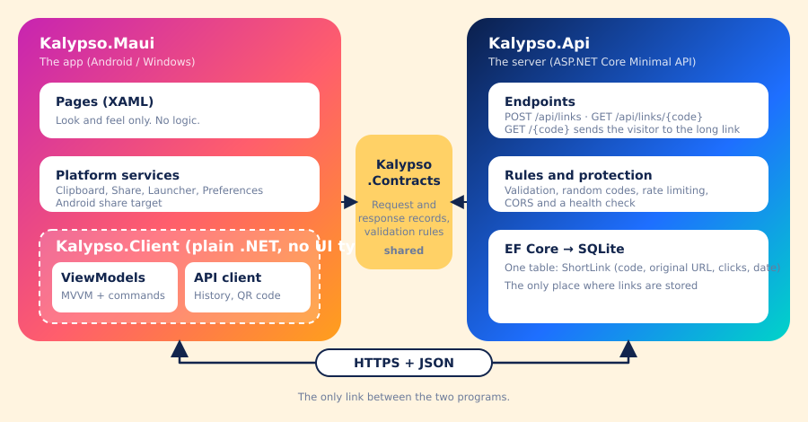
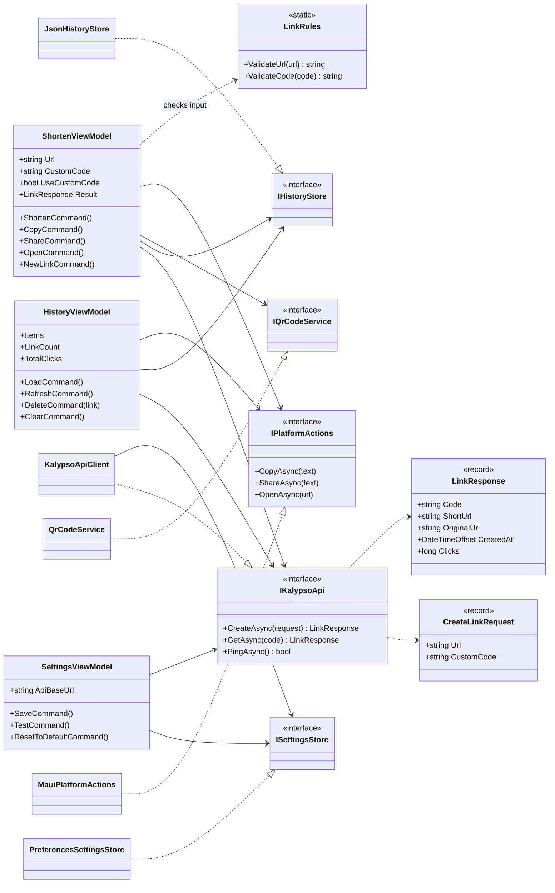
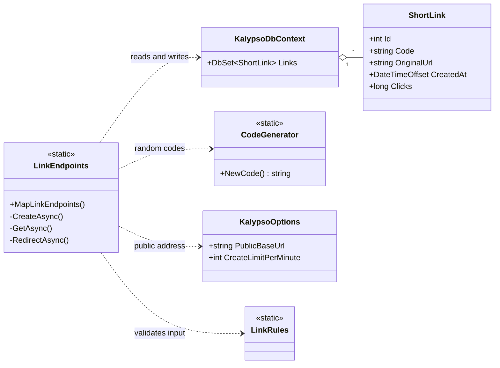
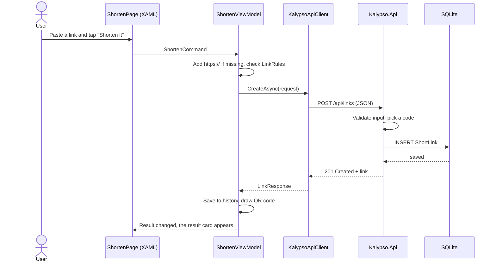
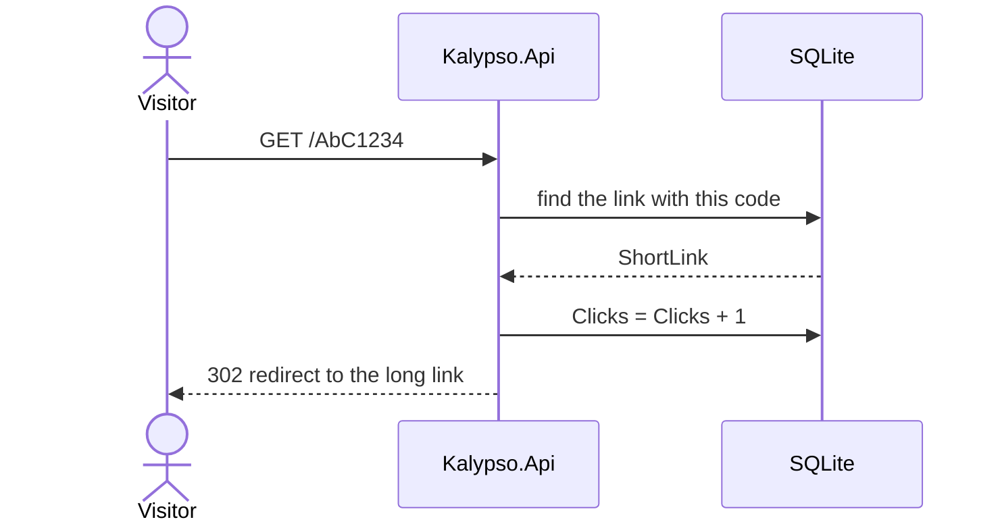

<p align="center">
  
</p>

<p align="center">
  <a href="https://github.com/NisanurBulut/KalypsoApp/actions/workflows/dotnet.yml"></a>
  
  
  
  <a href="LICENSE.txt"></a>
  <a href="https://github.com/NisanurBulut/KalypsoApp/releases"></a>
  &nbsp;⭐ <b>Like it? Give it a star!</b>
</p>

Kalypso makes long web links short. You paste a link, you get a short one, and you can copy it, share it,
open it or let a friend scan its QR code. The app also counts how often each short link is used.

It has two parts that are **separate programs**:

- **Kalypso.Api** – a small ASP.NET Core web service. It stores the links and sends visitors to the right place.
- **Kalypso.Maui** – a colourful .NET MAUI app for Android and Windows. It only shows screens and talks to the API.

The first version of this project (2023) was only the API, tested with Swagger. It is kept in
[legacy/KalypsoApp](legacy/KalypsoApp). This version rewrites it for .NET 10 and adds the app.

<p align="center">
  
  
  
  
</p>

<p align="center"><sub>Screenshots of the Windows build of the app.</sub></p>

## 🌊 Why "Kalypso"?

In Homer's *Odyssey*, **Calypso** (Greek: *Kalypsó*) is a nymph who lives on the island of Ogygia. Odysseus washes up
on her shore, and she keeps him there for seven years. Her name comes from the Greek word *kalyptein*, "to hide".

That fits: this app *hides* a long, ugly link behind a short, friendly one. The logo shows the sun over the sea
with a chain link on it. 🌅🔗

## Features

- **Short links** with a random 7-letter code, or a **name you choose** (for example `my-summer-trip`).
- **Click counter** for every link. Pull down on the History screen to refresh the numbers.
- **Copy, share, open** buttons and a **QR code** for every new link.
- **Share from other apps** (Android): choose *Kalypso* in the share menu of your browser and the link is already filled in.
- **History on the device**, so you still see your links without internet.
- **Safe API**: only `http` and `https` links are accepted, there is a rate limit, and bad input gets a clear message.
- **Settings screen** with a *Test connection* button, so you can point the app at any API address.

## How the two parts fit together

<p align="center">
  
</p>

| Part | What it does | What it must not do |
|---|---|---|
| `Kalypso.Api` | Validates input, makes codes, stores links, redirects visitors, counts clicks. | Know anything about screens. |
| `Kalypso.Maui` | Draws the screens, uses the phone (clipboard, share menu, browser). | Store links for other people or contain business rules. |
| `Kalypso.Client` | Everything the app *thinks*: view models, the API client, history, QR code. Plain .NET, so it can be unit-tested. | Use MAUI or any UI types. |
| `Kalypso.Contracts` | The request and response records and the validation rules, shared by both sides. | Depend on anything. |

The only connection between the app and the API is HTTPS with JSON. You can replace the app (for example with a web page)
or run the API without any app at all.

## Getting started

You need the [.NET 10 SDK](https://dotnet.microsoft.com/download). Only the app needs more (see step 2).

### 1. Run the API

```bash
dotnet run --project src/Kalypso.Api
```

It listens on `http://0.0.0.0:5299` (so a phone on your Wi-Fi can reach it) and creates a SQLite file `kalypso.db`.
Open `http://localhost:5299/openapi/v1.json` to see the API description, and `http://localhost:5299/health` to check that it runs.

### 2. Run the app

Install the MAUI workload once, then start the app on Windows or on an Android emulator or phone:

```bash
dotnet workload install maui
```

```bash
dotnet run --project src/Kalypso.Maui -f net10.0-windows10.0.19041.0
```

```bash
dotnet build src/Kalypso.Maui -f net10.0-android -t:Run
```

(With an Android emulator running or a phone connected by USB. In Visual Studio you can simply pick the target and press F5.)

Which API address should the app use? Open the **Settings** tab and press *Test connection*:

| Where the app runs | API address |
|---|---|
| Windows | `http://localhost:5299` (default) |
| Android emulator | `http://10.0.2.2:5299` (default; `10.0.2.2` means "the PC running the emulator") |
| Real Android phone | `http://<your PC's IP address>:5299`, on the same Wi-Fi. You may have to allow port 5299 in the Windows firewall. |
| Deployed API | `https://your-api.example.com` |

### 3. Deploy the API (optional)

When the API runs behind a proxy (a cloud host), tell it its public address, so short links point to the right place.
Settings can come from environment variables:

| Variable | Meaning | Default |
|---|---|---|
| `Kalypso__PublicBaseUrl` | Address used inside short links, e.g. `https://kly.example.com` | the address of the request |
| `Kalypso__CreateLimitPerMinute` | Links one IP address may create per minute | `30` |
| `ConnectionStrings__Default` | SQLite connection string, e.g. `Data Source=/data/kalypso.db` | `Data Source=kalypso.db` |

Put the database file on a persistent disk, or the links disappear when the host restarts.

## API

| Method | Path | What it does |
|---|---|---|
| `POST` | `/api/links` | Body `{ "url": "...", "customCode": "..." }` (the code is optional). Returns `201` and the new link. |
| `GET` | `/api/links/{code}` | Returns the link and its click count, or `404`. |
| `GET` | `/{code}` | Counts a click and redirects (`302`) to the long link. This is the short address people share. |
| `GET` | `/health` | Returns `200` when the service is running. |

Errors use the standard *problem details* format: `400` for bad input, `409` when a name is taken, `429` when you
create too many links too quickly. A custom name has 4–20 letters, numbers, `-` or `_`, and is case-sensitive.

## Solution layout

| Path | Content |
|---|---|
| `src/Kalypso.Contracts` | Shared records and validation rules. |
| `src/Kalypso.Api` | ASP.NET Core Minimal API with EF Core and SQLite. |
| `src/Kalypso.Client` | App logic without UI: view models (CommunityToolkit.Mvvm), API client, history store, QR codes. |
| `src/Kalypso.Maui` | The app: XAML pages, SVG artwork, Android and Windows startup code. |
| `tests/Kalypso.Api.Tests` | xUnit tests that start the real API with a temporary database. |
| `tests/Kalypso.Client.Tests` | xUnit tests for the view models, API client and history store. |
| `legacy/KalypsoApp` | The original 2023 API (.NET 7). Kept unchanged for reference. |

```bash
dotnet test tests/Kalypso.Api.Tests
dotnet test tests/Kalypso.Client.Tests
```

All images in the app (logo, icons, the island on the empty screen) are SVG files drawn for this project.
They live in `src/Kalypso.Maui/Resources` and `docs/images`.

## UML diagrams

### Classes in the app and the shared contracts



`ShortenViewModel`, `HistoryViewModel`, `SettingsViewModel` and the services up to `QrCodeService` live in
`Kalypso.Client`. `MauiPlatformActions` and `PreferencesSettingsStore` live in `Kalypso.Maui`, because only the
app can reach the clipboard or the phone's preferences.

### Classes in the API



### What happens when you shorten a link



### What happens when someone opens a short link



## Development workflow

Work happens on branches and reaches `master` by pull request. GitHub Actions builds and tests every pull request
(the API, the app logic and a Windows build of the MAUI app), and every merged pull request creates a release
`vMAJOR.MINOR.PATCH` (counting starts at `v0.0.0`):

| Branch name contains | Label on the pull request | Version change |
|---|---|---|
| `major` | `breaking` | `1.2.3` → `2.0.0` |
| `dev` | `enhancement` | `1.2.3` → `1.3.0` |
| anything else, e.g. `hotfix` | `bug` for `hotfix` | `1.2.3` → `1.2.4` |

The same rules are used in my other repositories.

## License

AGPL-3.0, see [LICENSE.txt](LICENSE.txt).

---

<p align="center">Made with ☕ and a lot of sea air. If you like it, <a href="https://github.com/NisanurBulut/KalypsoApp">⭐ star the repo</a>.</p>
